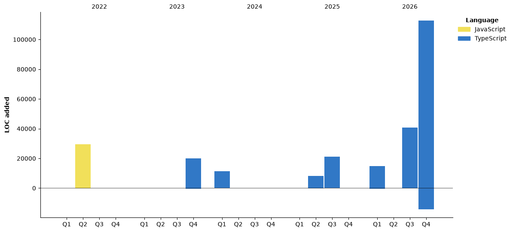

### Hi there 👋

## About Me
I edit text documents and push bits through the network stack.

## My GitHub Stats


<!--START_SECTION:waka-->


**🐱 My GitHub Data** 

> 📦 ? Used in GitHub's Storage 
 > 
> 🏆 98 Contributions in the Year 2026
 > 
> 💼 Opted to Hire
 > 
> 📜 26 Public Repositories 
 > 
> 🔑 0 Private Repositories 
 > 
**I'm a Night 🦉** 

```text
🌞 Morning                26 commits          █████░░░░░░░░░░░░░░░░░░░░   19.40 % 
🌆 Daytime                40 commits          ███████░░░░░░░░░░░░░░░░░░   29.85 % 
🌃 Evening                27 commits          █████░░░░░░░░░░░░░░░░░░░░   20.15 % 
🌙 Night                  41 commits          ████████░░░░░░░░░░░░░░░░░   30.60 % 
```
📅 **I'm Most Productive on Sunday** 

```text
Monday                   13 commits          ██░░░░░░░░░░░░░░░░░░░░░░░   09.70 % 
Tuesday                  9 commits           ██░░░░░░░░░░░░░░░░░░░░░░░   06.72 % 
Wednesday                5 commits           █░░░░░░░░░░░░░░░░░░░░░░░░   03.73 % 
Thursday                 10 commits          ██░░░░░░░░░░░░░░░░░░░░░░░   07.46 % 
Friday                   27 commits          █████░░░░░░░░░░░░░░░░░░░░   20.15 % 
Saturday                 12 commits          ██░░░░░░░░░░░░░░░░░░░░░░░   08.96 % 
Sunday                   58 commits          ███████████░░░░░░░░░░░░░░   43.28 % 
```


📊 **This Week I Spent My Time On** 

```text
🕑︎ Time Zone: Asia/Dhaka

💬 Programming Languages: 
Markdown                 12 mins             ████████████████░░░░░░░░░   65.01 % 
JSON                     4 mins              █████░░░░░░░░░░░░░░░░░░░░   20.24 % 
Rust                     2 mins              ████░░░░░░░░░░░░░░░░░░░░░   14.47 % 
TypeScript               0 secs              ░░░░░░░░░░░░░░░░░░░░░░░░░   00.29 % 

🔥 Editors: 
VS Code                  19 mins             █████████████████████████   100.00 % 

🐱‍💻 Projects: 
ktee                     19 mins             █████████████████████████   99.71 % 
dse-flextp-re            0 secs              ░░░░░░░░░░░░░░░░░░░░░░░░░   00.29 % 

💻 Operating System: 
Windows                  19 mins             █████████████████████████   100.00 % 
```

🤖 **AI Coding This Week** 

```text
No AI Coding Activity Tracked This Week
```

**I Mostly Code in TypeScript** 

```text
TypeScript               15 repos            ██████████████████████░░░   88.24 % 
JavaScript               1 repo              █░░░░░░░░░░░░░░░░░░░░░░░░   05.88 % 
HTML                     1 repo              █░░░░░░░░░░░░░░░░░░░░░░░░   05.88 % 
```


**Timeline**




 Last Updated on 14/11/2026 03:46:24 UTC
<!--END_SECTION:waka-->

<!--
**codesfromshad/codesfromshad** is a ✨ _special_ ✨ repository because its `README.md` (this file) appears on your GitHub profile.

Here are some ideas to get you started:

- 🔭 I’m currently working on ...
- 🌱 I’m currently learning ...
- 👯 I’m looking to collaborate on ...
- 🤔 I’m looking for help with ...
- 💬 Ask me about ...
- 📫 How to reach me: ...
- 😄 Pronouns: ...
- ⚡ Fun fact: ...
-->
